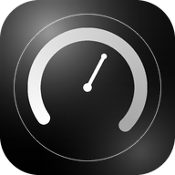
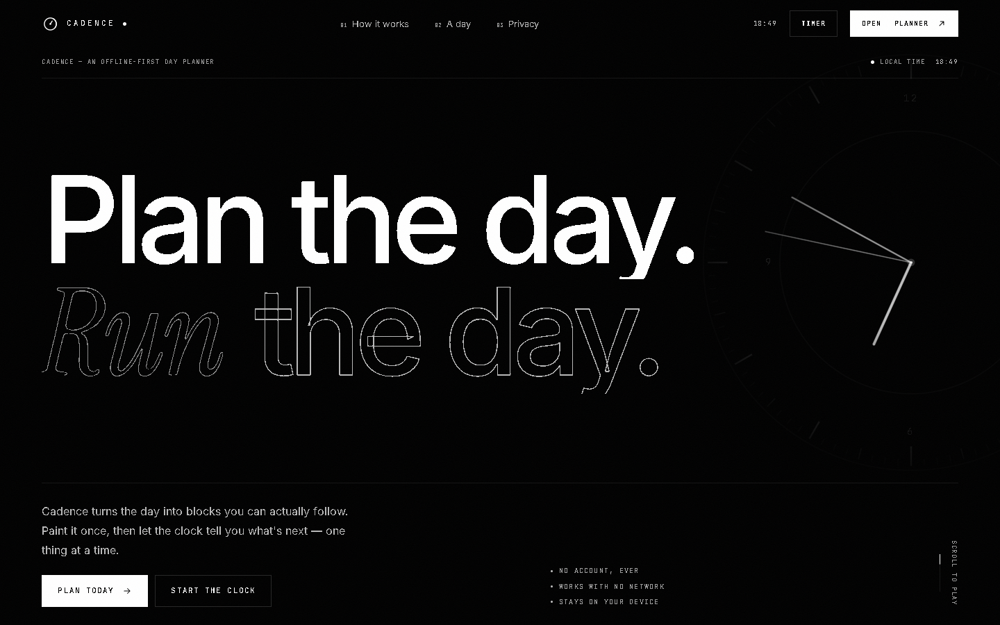
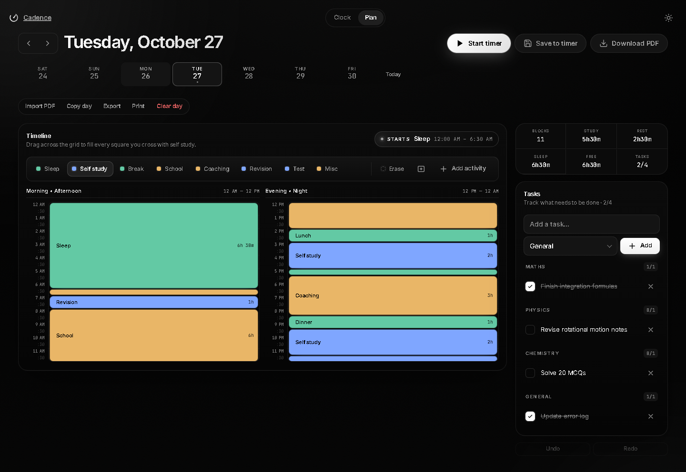
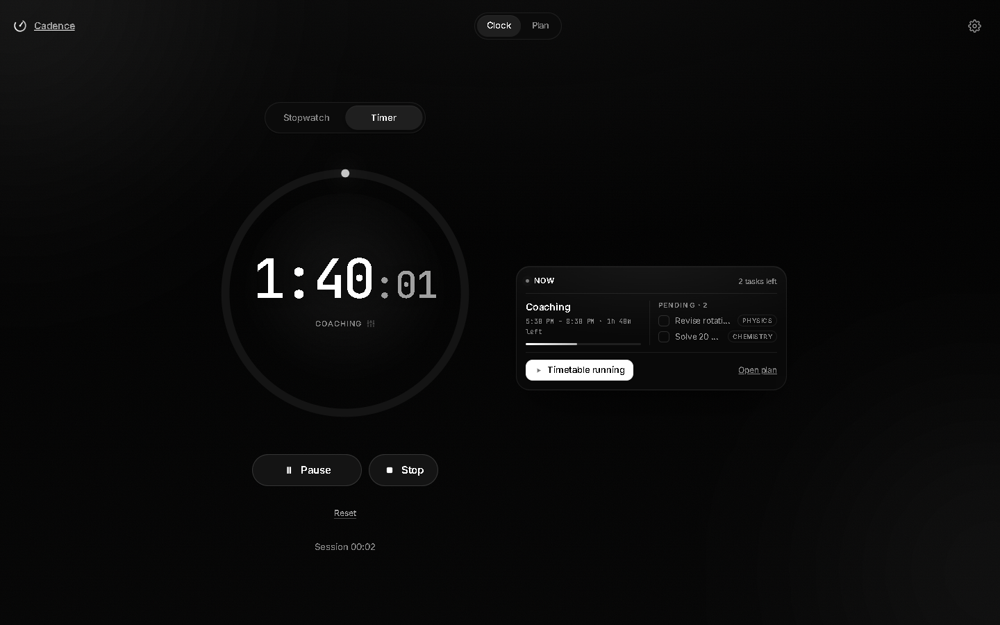
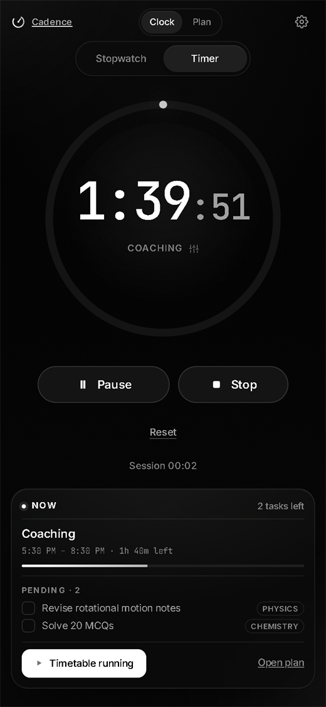

<p align="center">
  
</p>

<h1 align="center">Cadence</h1>

<p align="center">
  <strong>Plan the day. Run the day.</strong><br>
  An offline-first day planner built around a 24-hour grid — one block at a time.
</p>

<p align="center">
  <a href="https://cadenceapp.surge.sh/"><strong>Open the live app →</strong></a>
  &nbsp;·&nbsp;
  <a href="#getting-started">Run locally</a>
  &nbsp;·&nbsp;
  <a href="#screenshots">Screenshots</a>
</p>

<p align="center">
  
  
  
  
</p>

<a href="https://cadenceapp.surge.sh/">
  
</a>

Cadence is a day planner for people who want a plan they can actually follow. Paint the day into blocks on a 24-hour grid, attach the tasks that matter, then let the clock show only what is happening now. No account, no analytics, no server-side storage — the plan stays on your device.

## The idea

Most planners stop at a list. Cadence gives the day a shape: a 24-hour grid you paint in 30-minute blocks, with tasks attached to the date. The clock then runs the same plan, so there is only one version of what today is supposed to look like.

The default palette is built for study days — school, coaching, self-study, revision, tests — but you can add your own activities for anything else.

## Screenshots

### Plan the day



*The 24-hour planner: paint blocks, attach tasks, and see study, rest, sleep, and free time at a glance.*

### Run the day



*The focus clock: one block, the time left, and the next thing waiting.*

## Features

### Plan

- **Paint the day.** Drag across a 24-hour, 30-minute grid; every square you cross fills with the selected activity.
- **Shape it by hand.** Move, stretch, or erase blocks, and undo or redo changes as you go.
- **Keep the details.** Add tasks with stages, check them off, and see how the day breaks down into blocks, study, rest, sleep, free time, and tasks.
- **Start from an existing timetable.** Import a timetable PDF and turn its sessions into blocks.
- **Reuse a good day.** Copy a plan to another date, or save it to the timer.

### Run

- **One thing at a time.** The focus clock shows the current block, the time remaining, and the next block waiting.
- **Stopwatch or countdown.** Use a free-running stopwatch or a focus timer with break presets.
- **Make it automatic.** Chain focus and break sessions, or let the plan start each block on its own.
- **Stay in the room.** Optional sounds, countdown ticks, wake lock, and notifications.
- **See the work add up.** A daily focus goal and a session history.

### Review

- **Export the day.** Download JSON for a backup, or a PDF for a clean record.
- **Print a sheet.** A4 print layout with light or dark styling.
- **Keep it portable.** PDF exports carry the plan data, so they can be imported again.

### Private by design

- No sign-in, no server-side storage, and no analytics.
- Plans, tasks, sessions, and settings stay in `localStorage` on the device.
- The app is a PWA: install it, then use it offline.

## How it works

1. **Paint the day.** Open the planner, pick an activity, and drag across the grid.
2. **Set the clock.** Start the timer from the planner, or open the clock and continue the current block.
3. **Follow the day.** The clock shows one block at a time. When it ends, the next one is already waiting.

## Tech stack

Cadence is a static site with no build step and no package manager.

| Layer | Choice |
| --- | --- |
| UI | Semantic HTML, modern CSS, vanilla JavaScript (ES modules) |
| State | `localStorage`, with a versioned store key (`cadence.store.v1`) |
| Offline | Service worker and web app manifest |
| PDF | Vendored jsPDF and html2canvas |
| Motion | CSS transitions and a small Lenis-powered landing experience |
| Type | Instrument Serif, Inter, and JetBrains Mono, self-hosted |

## Getting started

Cadence is plain static files. There is nothing to install or build.

### Run locally

```sh
git clone https://github.com/rudra-th/Cadence.git
cd Cadence
python serve.py
```

Open [http://localhost:4173](http://localhost:4173). To use a different port:

```sh
python serve.py 8000
```

Any static server works:

```sh
python -m http.server 8000
```

> Use `localhost` or HTTPS rather than `file://`. Service workers — and therefore the offline and PWA behaviour — need a secure context.

### A quick tour

1. **Plan.** Choose an activity, then drag across the grid to paint blocks. Select a block to move, resize, or delete it.
2. **Add context.** Type a task, import a timetable PDF, or copy a previous day.
3. **Run it.** Press **Start timer** on the planner, or open the clock and press **Continue Timetable**.
4. **Review.** Export JSON, download a PDF, or print an A4 sheet at the end of the day.

## Install it, then go offline



Cadence is a progressive web app. Open it in a modern browser and use **Install app** (or **Add to Home Screen**). After the first load, the service worker keeps the app shell available offline; plans are already stored locally, so the app opens even without a network.

The layout adapts to phones, tablets, and desktops. On smaller screens the clock stacks the timer and agenda, while the planner keeps its two-column day grid.

Installation prompts depend on the browser and platform. Chrome and Edge support installation on desktop and Android; Safari on iOS uses **Add to Home Screen**.

## Data and privacy

Cadence does not send your plans anywhere. There is no backend, no account, and no analytics.

- Plans, tasks, sessions, and settings are stored under `cadence.store.v1` in `localStorage`.
- Clearing site data or browser storage removes everything. Export a JSON backup first if the plan matters.
- The only network requests are for the app's own static files.
- Optional notifications and wake lock are browser features; they do not transmit data.

## Project structure

```text
.
├── index.html               # Landing page and the four-act introduction
├── plan.html                # 24-hour planner
├── clock.html               # Focus clock, timer, and stopwatch
├── app.html                 # Small redirect to clock.html
├── sw.js                    # Service worker and offline cache
├── manifest.webmanifest     # PWA metadata
├── serve.py                 # Local static server (development only)
├── assets/
│   ├── css/                 # App styles and landing experience
│   ├── fonts/               # Self-hosted typefaces
│   ├── icons/               # App and PWA icons
│   ├── js/
│   │   ├── store.js         # Versioned localStorage store
│   │   ├── plan.js          # Plan model and grid operations
│   │   ├── planpage.js      # Planner UI
│   │   ├── clock.js         # Clock and timer UI
│   │   ├── timetable.js     # Timetable parsing
│   │   └── pdf.js           # PDF and print output
│   └── vendor/              # jsPDF, html2canvas, Lenis
└── docs/screenshots/        # README images
```

## Deployment

Deploy the repository root as static files. No server-side code, database, or environment variables are required.

The included `CNAME` points at `cadenceapp.surge.sh` for Surge:

```sh
surge ./ cadenceapp.surge.sh
```

For another host, remove or update `CNAME` and point the host at the repository root. No rewrite rules are required.

## Browser support

Built for current evergreen browsers: Chrome, Edge, Firefox, and Safari. The core planner and clock work without a network; PWA installation, wake lock, and notifications depend on the browser and platform. The app respects `prefers-reduced-motion` and includes keyboard-accessible controls.

## Acknowledgements

- [jsPDF](https://github.com/parallax/jsPDF) and [html2canvas](https://html2canvas.hertzen.com/) for PDF export.
- [Lenis](https://github.com/darkroomengineering/lenis) for the landing page's scroll feel.
- Instrument Serif, Inter, and JetBrains Mono, served locally.

## Author

Built by **Rudra Thorat** — [@rudra-th](https://github.com/rudra-th).

If you find a bug or have an idea, [open an issue](https://github.com/rudra-th/Cadence/issues).

<p align="center"><sub>© 2026 Rudra Thorat</sub></p>
